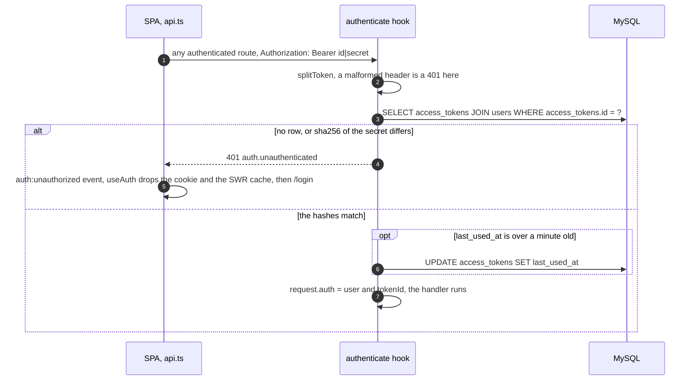
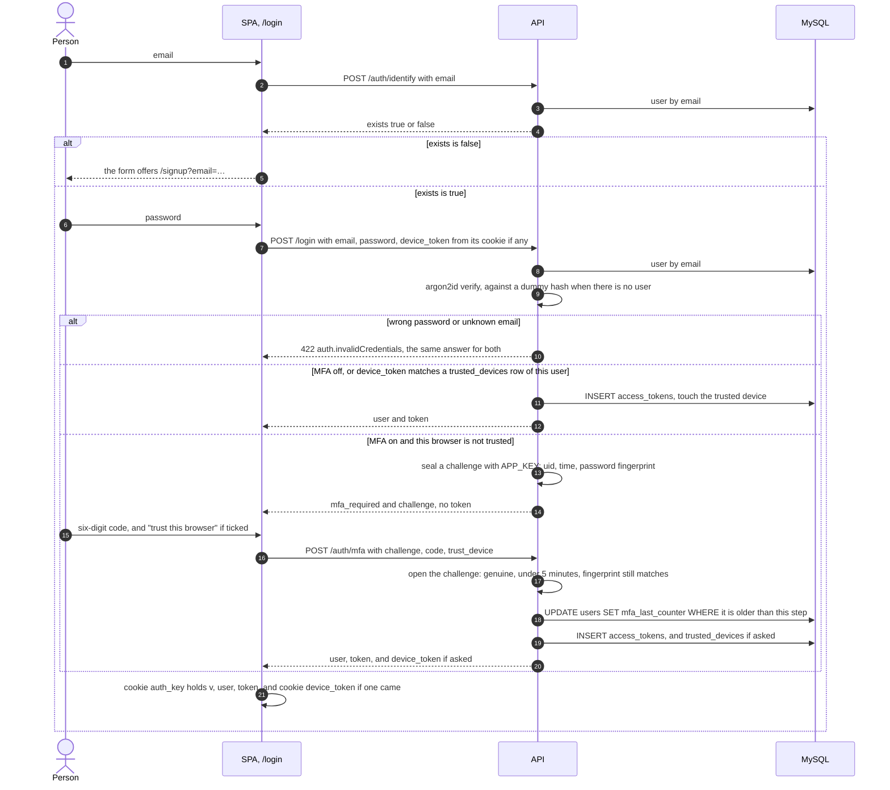
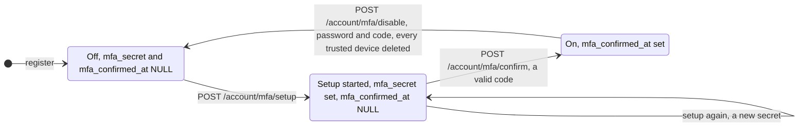
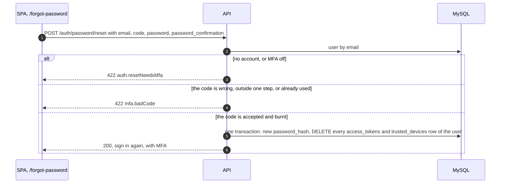
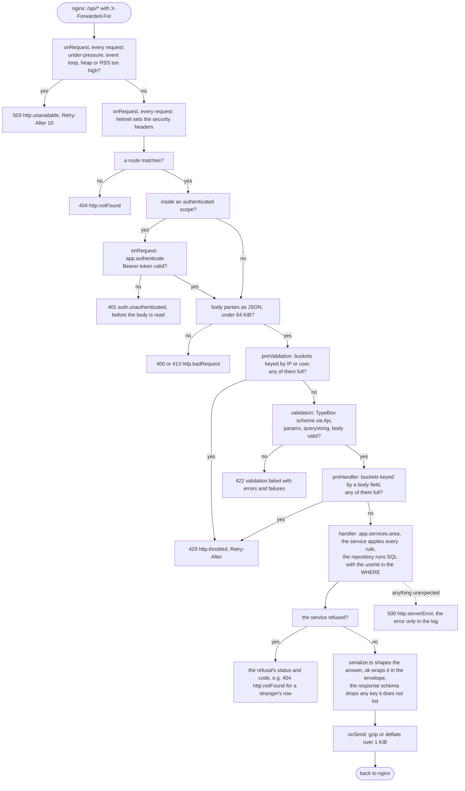

# The API

The request/response contract, sessions and MFA, and the whole route surface.
Every path below is under `/api`, which nginx forwards to the backend.

---

## Request/response contract

### Envelope

```json
{ "success": true, "data": "<T>", "message": "optional human string" }
```

A refusal carries more, because it travels twice: once as English prose and
once as data the client can branch on.

| Key | Set by | Read by |
|---|---|---|
| `message` | every refusal | a person, a log, the frontend's `<Alert>` |
| `code` | a refusal class (`backend/src/lib/errors.ts`) or `validation.failed` | the frontend, only where it must act differently |
| `errors` | `{ field: [message] }`, from a route schema's `errorMessage` or from a refusal with a field | the frontend, under each input (`ApiError.field`) |
| `failures` | `{ field: [Ajv keyword] }` on a 422 validation (`required`, `minLength`, `format`…) | a client that wants the rule, not the prose |
| `params` | a refusal, e.g. `{ retry_after }` on 429 | the frontend |

`backend/src/plugins/errors.ts` turns anything the app did not throw on
purpose into a flat 500 with no stack or query text. Fastify's own 4xx
(malformed JSON, wrong content type) keep their status as `http.badRequest`.

Status codes in use: 200, 201, 400, 401, 404, 413, 422, 429, 500, 503.

### Error codes

| Code | Status | When |
|---|---|---|
| `validation.failed` | 422 | a route schema refused the params, body or query; see `errors` |
| `auth.invalidCredentials` | 422 | wrong password or unknown email; the same answer for both |
| `auth.emailTaken` | 422 | register with an address that has an account |
| `auth.challengeExpired` | 422 | the MFA challenge is forged, over 5 minutes old, or the password changed since |
| `auth.resetNeedsMfa` | 422 | password reset for an address without MFA (or unknown) |
| `auth.wrongPassword` | 422 | change password / turn MFA off with the wrong current password |
| `auth.unauthenticated` | 401 | no, malformed, forged or revoked Bearer token |
| `mfa.badCode` | 422 | a TOTP code that is wrong, outside ±1 step, or already used |
| `mfa.alreadyEnabled` / `mfa.notEnabled` / `mfa.notStarted` | 422 | an MFA action out of order |
| `habits.startInFuture` | 422 | a habit's `started_on` after today (in `tz`) |
| `habits.dateOutOfRange` | 422 | a check-in before the habit started or after today |
| `goals.habitNotFound` | 422 | a goal linked to a habit that is not yours, archived or missing |
| `http.throttled` | 429 | a rate limit; `params.retry_after` in seconds, also the `Retry-After` header |
| `http.notFound` | 404 | no such route, or a row that is not yours |
| `http.badRequest` | 4xx | Fastify refused the request before a handler ran |
| `http.unavailable` | 503 | the backend is over its load limits (`plugins/under-pressure.ts`); `params.retry_after` and the `Retry-After` header say when to come back |
| `http.serverError` | 500 | anything unexpected; details only in the backend log |

### Frontend unwrapping

`frontend/src/services/api.ts` is the only place `fetch` is called. It attaches
`Authorization: Bearer <token>` from the `auth_key` cookie, reads the body as
text first (so a proxy's HTML error page is still an `ApiError`), throws
`ApiError` for anything but `success: true`, and dispatches the
`auth:unauthorized` window event on any 401. GETs in flight are shared by
endpoint. POST and PUT always send a JSON body, `{}` when there is nothing to
send (`RULES.md` §6). Pages never call it for a read: `hooks/useData.ts` runs
every GET through SWR, keyed by the endpoint, and a write's answer is put into
that cache by the area's hook.

---

## Sessions

A token is `<row id>|<secret>`: `AccountService.issueToken` writes a row in
`access_tokens` holding `sha256(secret)`, and the client keeps `{ v, user, token }`
as one JSON cookie, `auth_key`. Every later request carries it:



What ends a session, a trusted device, or a challenge in flight:

| Event | `access_tokens` | `trusted_devices` | Unanswered MFA challenges |
|---|---|---|---|
| `POST /logout` | the one it was sent with | | |
| `PUT /account/password` | every one but this | | dead: the password fingerprint changed |
| `POST /auth/password/reset` | all | all | dead, same reason |
| `POST /account/mfa/disable` | | all | dead: `/auth/mfa` needs MFA on |
| Forget one device / all devices | | that one / all | |

- **A session never expires.** There is no expiry column and no age check;
  a token dies only on logout, password change (all others), or password
  reset (all). `backend/test/auth.test.ts` "has no expiry" pins it.
- The database stores only `sha256(secret)`.
- `last_used_at` is touched at most once a minute.
- The cookie lasts 400 days and is rewritten on every load
  (`refreshAuthCookies`), because a browser will not keep one longer.
- **The SPA trusts the cookie's user on load and does not call `/me`.** A
  dead token surfaces as the 401 on the page's first request. Account
  changes answer with the fresh user, which `replaceUser` writes back.
- Route guarding in the SPA reads the cookie and is only a UX hint. The gate
  is `authenticate`.

### Email-first sign-in



`identify` tells anyone whether an address is registered. Accepted: the form
cannot choose its next screen otherwise (`docs/security.md` §2).

### Two-factor (TOTP)

- **Setup is two steps.** `POST /account/mfa/setup` stores a new secret
  (encrypted with `APP_KEY`) and returns `{ secret, otpauth_url }`; MFA is
  not on until `POST /account/mfa/confirm { code }` sees a valid code from
  it and sets `mfa_confirmed_at`.
- **The challenge** is AES-256-GCM over `{ uid, at, pw }`, sealed with
  `APP_KEY`, not stored. It dies after 5 minutes, and `pw` (a digest of the
  password hash) kills it the moment the password changes.
- **A code is single use.** `matchCounter` returns the 30-second step a code
  belongs to, and `consumeCode` writes it to `mfa_last_counter` only if it is
  newer than the last one accepted, in the same `UPDATE … WHERE`. Without
  that, the ±1 step window keeps an observed code valid for about 90 seconds.
- **Trusted devices**: `trust_device: true` on `/auth/mfa` returns a
  `device_token` (same `<id>|<secret>` shape, hashed at rest) that the client
  keeps in the `device_token` cookie and sends with `/login`. It has no
  expiry either; it is removed from the Account page, by turning MFA off, or
  by a password reset.
- **Turning MFA off** needs the password *and* a code, so a stolen session
  alone cannot remove the second factor.

The MFA columns of `users` move through three states. A setup that was
started and never confirmed leaves sign-in as it was: MFA is off until
`mfa_confirmed_at` is set.



| Call in the wrong state | Answer |
|---|---|
| setup or confirm while On | 422 `mfa.alreadyEnabled` |
| confirm while Off | 422 `mfa.notStarted` |
| disable while Off or Pending | 422 `mfa.notEnabled` |

### Password reset, proven by the authenticator



There is no email in this stack, so an authenticator code is the only proof
of identity available. The user signs in again afterwards, with MFA.

---

## Backend layering

```
plugins/auth.ts    app.authenticate: @fastify/bearer-auth, an onRequest hook, sets request.auth
schema             params · querystring · body checked by Ajv before the handler; response drops unlisted keys
config.limits      buckets counted by plugins/rate-limit.ts, before validation or (afterValidation) after
routes.ts          service → ok(serialize(…))
service.ts         every rule and every transaction
repository.ts      every query, tenant filter included
plugins/errors.ts  refusal / ValidationFailed / Fastify 4xx / anything else → the envelope
```

### One request, end to end

Fastify's lifecycle stages, top to bottom, with the hook this app puts on
each. Any refusal on the way is thrown, and `plugins/errors.ts` turns it into
the envelope.



Two timeouts sit outside the diagram: a request still unfinished after 30
seconds is dropped, and on shutdown requests in flight get 10 seconds.

---

## Routes

**Public**

| Path | Limits | Notes |
|---|---|---|
| `GET /health` | | `SELECT 1`; the compose healthcheck. Not logged |
| `POST /auth/identify` | 20/min per IP | |
| `POST /register` | 20/h per IP | 201 with a session |
| `POST /login` | 5/min per email+IP, 10/15 min per email, 60/min per IP | so a shared carrier IP does not lock out everyone behind it |
| `POST /auth/mfa` | 10/min per IP, 5 per challenge | six digits are only strong while guesses are few |
| `POST /auth/password/reset` | 5/15 min per email+IP, 10/h per email | |

**Authenticated (`authenticate`)**

| Path | Notes |
|---|---|
| `POST /logout` | deletes the token it was sent with |
| `GET /me` | the user. The SPA does not call it (Sessions, above) |
| `PUT /account/password` | needs `current_password`; signs out every other token. 10/min per user |
| `POST /account/mfa/setup` · `/confirm` · `/disable` | 10/min per user. Disable is POST because the proof travels in the body |
| `GET /account/devices` | trusted devices, most recently used first |
| `DELETE /account/devices/all` · `/account/devices/:id` | scoped by user in the same query; a stranger's id is 404 |

**Habits, goals and statistics (`authenticate`)**. Every one takes `?tz=` (`habits.md`); writes spend 120/min per user, one bucket for habits and another for goals (`docs/security.md` §4).

| Path | Notes |
|---|---|
| `GET /habits` | active habits, oldest first, each with `logs`, `stats`, `weeks` |
| `POST /habits` | `{ name, type, icon, started_on? }`, 201; `started_on` defaults to today |
| `GET /habits/:id` · `PUT /habits/:id` | `PUT` takes `{ name, icon, started_on }`; the type is fixed |
| `DELETE /habits/:id` | archives the habit and its goals; the log stays |
| `PUT` · `DELETE /habits/:id/logs/:date` | mark or clear one day (`YYYY-MM-DD`), idempotent; answers the updated habit |
| `GET /goals` · `POST /goals` | `{ habit_id, title, target_days?, notes? }`; each goal embeds its habit and `progress` |
| `PUT /goals/:id` · `DELETE /goals/:id` | same body as `POST`; delete removes the row |
| `GET /stats?period=week\|month\|year` | every active habit added up per bucket (`habits.md`, Statistics); `period` defaults to `week` |

Statistics add up only the caller's habits. A stranger's habit or goal id is 404 on every route, from the same `where { id, userId }`.
