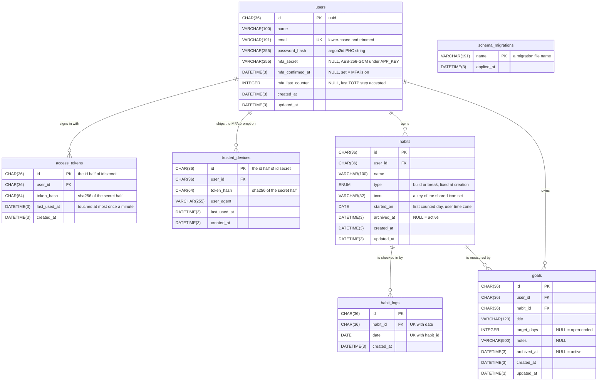

# Schema and the ERD

The tables, how they relate, and what the database itself enforces. The
schema is `backend/migrations/*.sql`, in order; this file is its picture.
**A migration that adds or drops a table, a column, a foreign key or an index
updates this file in the same change** (`.claude/rules/backend.md`). If the
two disagree, the migrations win.

---

## Entity-relationship diagram

`||` is exactly one and `o{` is zero or more. Every table is InnoDB,
`utf8mb4_unicode_ci`. `schema_migrations` stands alone: `src/migrate.ts`
creates it, no migration does, and nothing references it.

## Relationships

| Parent → child | Cardinality | Foreign key | On delete | A child row is |
|---|---|---|---|---|
| `users` → `access_tokens` | 1 → 0..n | `access_tokens.user_id` | `CASCADE` | one signed-in session (`api.md`, Sessions) |
| `users` → `trusted_devices` | 1 → 0..n | `trusted_devices.user_id` | `CASCADE` | one browser that may skip the MFA prompt |
| `users` → `habits` | 1 → 0..n | `habits.user_id` | `CASCADE` | one habit, active or archived |
| `users` → `goals` | 1 → 0..n | `goals.user_id` | `CASCADE` | one goal; the column is there so every goal query filters by user in one `WHERE` |
| `habits` → `habit_logs` | 1 → 0..n, **at most one per date** | `habit_logs.habit_id`, unique with `date` | `CASCADE` | done that day (build) or relapsed that day (break), `habits.md` |
| `habits` → `goals` | 1 → 0..n; a goal has exactly one habit | `goals.habit_id` | `CASCADE` | a streak target on that habit |

Every foreign key is also `ON UPDATE CASCADE`, which never fires: an id is a
uuid the backend writes once.

## What no constraint enforces

These hold because the services check them, so a new write path must check
them too.

| Rule | Held by |
|---|---|
| A goal's habit belongs to the goal's own user (`goals.user_id` = `habits.user_id`) | `GoalService` loads the habit with `activeOne(userId, habitId)` first; otherwise `goals.habitNotFound` |
| A goal links only to an active habit | the same `activeOne` (`archived_at IS NULL`) |
| `habit_logs` has no `user_id`; a log row is reached only through its habit | `HabitService.setLog` loads the habit by id **and** user before touching the log |
| A log date lies between `started_on` and today in the user's zone | `HabitService.setLog`, `habits.dateOutOfRange` |
| `type` never changes after creation | `PUT /habits/:id` has no `type` in its body |
| MFA is on only when `mfa_confirmed_at` is set; a secret without it is an unfinished setup | `AccountService`, `AuthService.login` |
| `email` is stored lower-cased and trimmed, so the unique index sees one spelling | the `normalize` keyword in the route schemas (`lib/validation.ts`) |

## Row lifecycle

Nothing in the app deletes a user (`README.md`, Known gaps) or a habit, so the
cascades from `users` and `habits` are a backstop for a manual delete, not a
code path.

| Table | Created by | Changed by | Removed by |
|---|---|---|---|
| `users` | `POST /register` | password change or reset (`password_hash`); MFA setup, confirm, disable and every accepted code (`mfa_*`) | never |
| `access_tokens` | register, login, `/auth/mfa` | `last_used_at` on use | logout (that one), password change (every other), password reset (all) |
| `trusted_devices` | `/auth/mfa` with `trust_device: true` | `last_used_at` on a login that skips MFA | forget one or all, MFA off (all), password reset (all) |
| `habits` | `POST /habits` | `PUT /habits/:id`; `DELETE /habits/:id` sets `archived_at` | never; the log is user data |
| `habit_logs` | `PUT /habits/:id/logs/:date` (a duplicate is ignored) | never | `DELETE /habits/:id/logs/:date` |
| `goals` | `POST /goals` | `PUT /goals/:id`; archived with its habit, in the same transaction | `DELETE /goals/:id` |
| `schema_migrations` | `src/migrate.ts`, one row per applied file | never | never |

## Indexes

| Table | Index | Columns | Serves |
|---|---|---|---|
| `users` | `users_email_key` (unique) | `email` | sign-in lookup; a second account on one address fails as `ER_DUP_ENTRY` → `auth.emailTaken` |
| `access_tokens` | primary key | `id` | every authenticated request: the token's id half is one primary-key read |
| `access_tokens` | `access_tokens_user_id_idx` | `user_id` | signing out every other session |
| `trusted_devices` | primary key | `id` | the device check at login (`id` and `user_id`) |
| `trusted_devices` | `trusted_devices_user_id_idx` | `user_id` | the device list on the Security page |
| `habits` | `habits_user_id_archived_at_idx` | `user_id`, `archived_at` | a user's active habits |
| `habit_logs` | `habit_logs_habit_id_date_key` (unique) | `habit_id`, `date` | one row per day; a double check-in is `ER_DUP_ENTRY`, ignored |
| `goals` | `goals_user_id_archived_at_idx` | `user_id`, `archived_at` | a user's active goals |
| `goals` | `goals_habit_id_idx` | `habit_id` | archiving a habit's goals |

## Two databases, one schema

`habit_shaper` is the app's; `habit_shaper_test` is created by
`db/init/01-test-database.sql` and wiped by the backend suite. `src/migrate.ts`
brings both to the same schema (`deployment.md`, Schema bootstrap).
