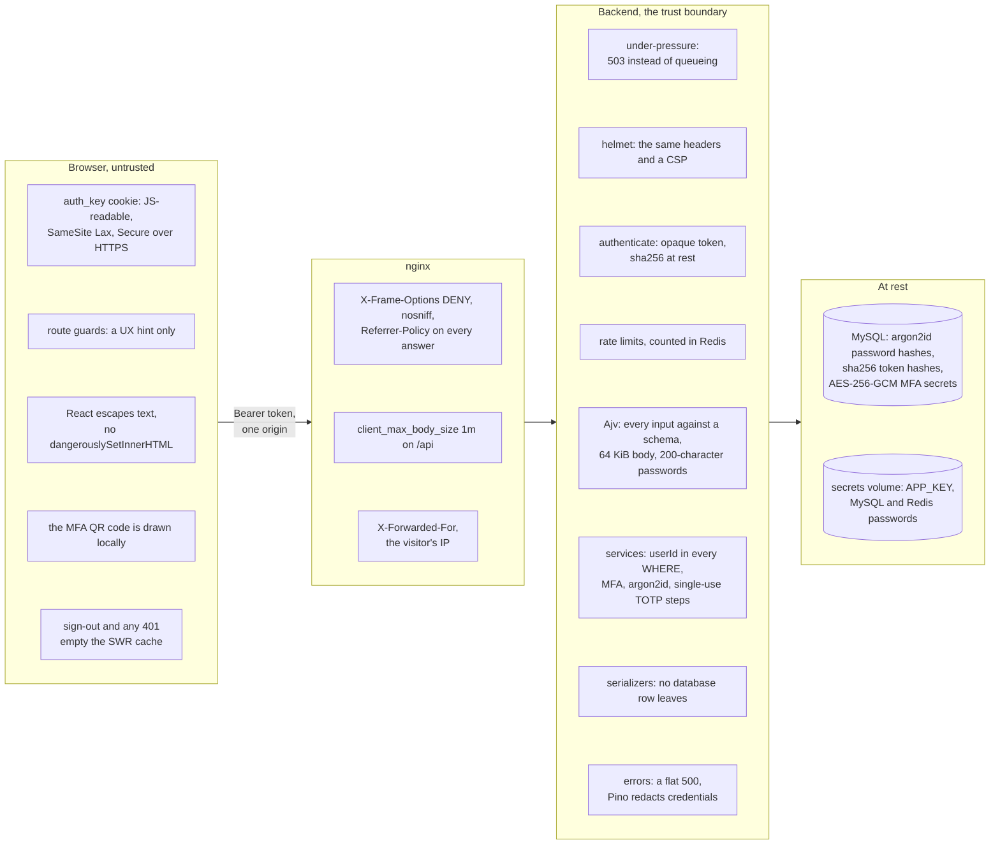
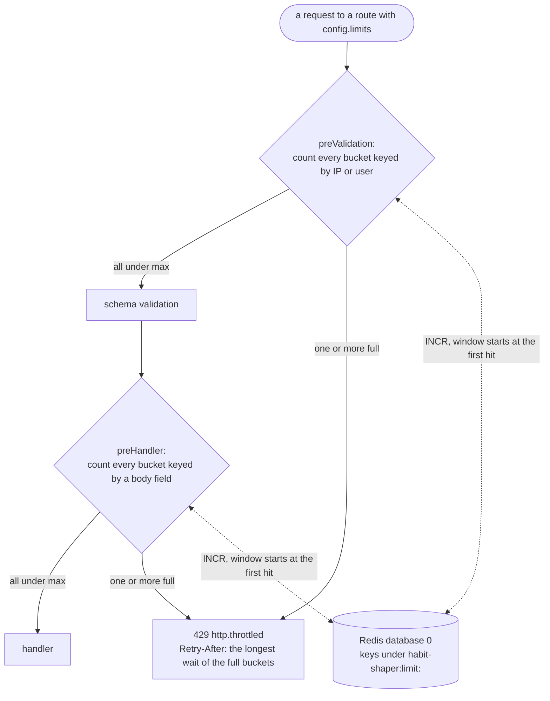
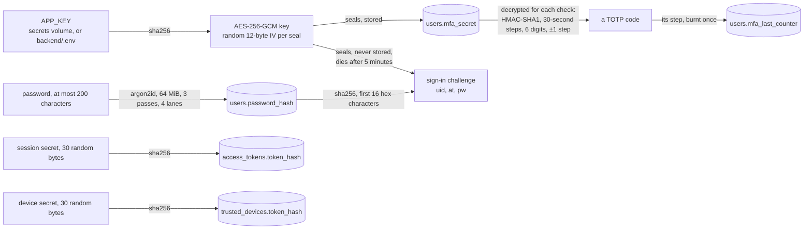

# Security posture

What holds today, what to watch, and which test pins each claim. The model in
one line: **the API is the only trust boundary.** Route guards in the SPA are a
UX hint; every check that matters runs server-side, keyed to a Bearer token.

---

## 1. What holds

| Attack | Control | Tested by |
|---|---|---|
| Password database leak | argon2id (64 MiB, 3 passes, 4 lanes, random salt) in `backend/src/lib/password.ts` | `auth.test.ts` "stores the password as an argon2id hash" |
| Token database leak | Access tokens and device tokens are stored as sha256 of the secret; the plaintext exists only in the client | `auth.test.ts` "refuses a missing, malformed, or forged token" |
| MFA secret leak from the database | Encrypted with AES-256-GCM under `APP_KEY` (`lib/crypto.ts`) | `mfa.test.ts` "stores the secret encrypted" |
| Secret leakage in a response | Every response goes through a serializer; no database row is sent | `auth.test.ts` "never sends the password hash or the MFA secret" |
| Password guessing | Login limited per email + IP, per email, and per IP (`modules/auth/routes.ts`), counted in Redis | `auth.test.ts` "throttles guessing at one address"; `limits.test.ts` |
| TOTP guessing | `/auth/mfa` limited per IP and to 5 tries per challenge; a challenge needs the password first | — (limits are the same mechanism as login's) |
| TOTP replay | `mfa_last_counter` burns the accepted step atomically (`AccountService.consumeCode`) | `mfa.test.ts` "accepts each code once" |
| Forged or stale MFA challenge | AES-GCM sealed, 5-minute TTL, password fingerprint | `mfa.test.ts` "refuses a forged challenge", "…older than its lifetime"; `password.test.ts` "kills a challenge issued before the reset" |
| MFA removed by a stolen session | Turning it off needs the password and a code | `mfa.test.ts` "needs the password and a code" |
| Password change that leaves an intruder in | Needs the current password and deletes every other token | `password.test.ts` "keeps this session and signs every other one out" |
| Reset by someone who only knows the email | Reset needs a TOTP code; accounts without MFA cannot reset at all | `password.test.ts` "is refused for an account without MFA" |
| Reset that leaves an intruder in | Deletes every token and trusted device | `password.test.ts` "sets the new password and signs out every session and trusted device" |
| Cross-tenant access (IDOR) | Every user-row query carries `userId` from the token in the same `where` | `mfa.test.ts` "can be listed and removed, but never someone else's"; `habits.test.ts` "never shows, logs, edits or deletes someone else's habit"; `goals.test.ts` "never edits or deletes someone else's goal" and "refuses … a habit that is not yours" |
| Enumerating rows by id | A stranger's row and a missing row answer the identical 404 | same |
| SQL injection | Every value is a `?` placeholder that `mysql2` escapes; only constants in the repositories name a table or column | — (grep-verifiable: no `${` inside a value position in `modules/*/repository.ts`) |
| Stack or SQL disclosure | Unexpected errors become a flat 500 (`plugins/errors.ts`) | `plugins.test.ts` "turns anything unexpected into a flat 500"; `auth.test.ts` "answers malformed JSON with a 400, not a 500" |
| A credential in the logs | Pino redacts the Authorization and Cookie headers and every password, token, challenge and secret field (`lib/logging.ts`) | `hardening.test.ts` "never writes a credential to the log" |
| One account's data shown to the next on a shared browser | Signing out, and any 401, empties the SWR cache before `/login` (`useAuth`) | `routes.test.tsx` "signing out forgets every cached answer", "…answers 401, and forgets what it cached" |
| DOM XSS | No `dangerouslySetInnerHTML` in `frontend/src`; React escapes text | — (grep-verifiable) |
| MFA secret sent to a third party | The QR code is drawn in the browser by the `qrcode` package | — (no network call in `MfaSection.tsx`) |
| Clickjacking, MIME sniffing | `X-Frame-Options: DENY`, `X-Content-Type-Options: nosniff` on every nginx response; `@fastify/helmet` sends the same and a CSP from the API itself | `hardening.test.ts` "sends the security headers on API answers" |
| Oversized password as a CPU attack | Passwords capped at 200 characters before hashing | `schemas.ts` |
| Oversized bodies, slow requests, overload | 64 KiB body limit, 30-second request timeout, and `@fastify/under-pressure` answering 503 past its thresholds | `hardening.test.ts` |

---

## 2. What to watch

### 2.1 Account enumeration is accepted

`POST /auth/identify` says whether an address is registered, and reset says
whether an address has MFA. Both are needed for the forms to choose their next
screen. Login itself answers a wrong password and an unknown email
identically. Revisit if the product's threat model changes.

### 2.2 The token is readable by JavaScript

The `{user, token}` cookie is read by the SPA, so any XSS could read it. The
defence is that there is no XSS (§1). Keep `dangerouslySetInnerHTML` out.

### 2.3 Sessions never expire

A stolen token works until the user signs out, changes the password, or
resets it. The reasoning is in `decisions.md`. The Account
page does not yet list sessions, so the user cannot see or revoke one
specifically; only "change password" revokes the others.

### 2.4 Who may set X-Forwarded-For

The backend trusts `X-Forwarded-For` from loopback and private addresses
(`TRUST_PROXY`). In compose that is nginx, which is correct. A client that
itself sits on a private network in front of the app (the same LAN, or the
Docker host) is trusted too and can choose the IP its rate limits count
against. Narrow `TRUST_PROXY` to the proxy's exact address if the app is ever
reachable from an untrusted private network.

### 2.5 `APP_KEY` is a single point of failure

It seals MFA secrets and challenges. It has no default anywhere: `backend/.env` sets
it, or the `secrets` service generates it on first boot, and the tests read
the same one. Back it up
(`docker compose run --rm secrets cat /secrets/app_key`): losing it locks out every
MFA account.

### 2.6 No Content-Security-Policy

Nothing needs one today (no inline scripts, escaped output), but a CSP would
turn a future XSS into a blocked request. It belongs in `frontend/nginx.conf`.

---

## 3. Where each control sits

Every layer a request crosses, and what it holds against. Only the backend is
a trust boundary; the browser's controls protect the user, not the API.

## 4. Rate limits

A route lists the buckets it spends (`config.limits`); `plugins/rate-limit.ts`
counts them in two stages. Every bucket of a stage is counted before any
refuses, so a full bucket never hides another's count, and the 429 waits for
the fullest one.

Counting IP buckets before validation means a malformed request still spends
one; a bucket keyed by email or challenge needs the validated body, so it
counts after.

| Bucket | Routes | Max per window | Key | Stage |
|---|---|---|---|---|
| `identify` | `POST /auth/identify` | 20 / minute | IP | preValidation |
| `register` | `POST /register` | 20 / hour | IP | preValidation |
| `login-ip` | `POST /login` | 60 / minute | IP | preValidation |
| `login` | `POST /login` | 5 / minute | email + IP | preHandler |
| `login-email` | `POST /login` | 10 / 15 minutes | email | preHandler |
| `mfa` | `POST /auth/mfa` | 10 / minute | IP | preValidation |
| `mfa-challenge` | `POST /auth/mfa` | 5 / 5 minutes | the challenge's last 32 characters | preHandler |
| `reset` | `POST /auth/password/reset` | 5 / 15 minutes | email + IP | preHandler |
| `reset-email` | `POST /auth/password/reset` | 10 / hour | email | preHandler |
| `password` | `PUT /account/password` | 10 / minute | user | preValidation |
| `account-mfa` | `POST /account/mfa/setup`, `/confirm`, `/disable` | 10 / minute, shared | user | preValidation |
| `habits-writes` | every `POST`, `PUT`, `DELETE` under `/habits` | 120 / minute, shared | user | preValidation |
| `goals-writes` | every `POST`, `PUT`, `DELETE` under `/goals` | 120 / minute, shared | user | preValidation |

A user-keyed bucket counts after `authenticate`, so an anonymous request is
a 401 and spends nothing. Outside Docker the same buckets count in process
memory (`RULES.md` §6).

## 5. Keys and what they protect

| Lost or leaked | Consequence |
|---|---|
| `APP_KEY` lost or changed | every MFA account is locked out, sign-in and reset alike (§2.5) |
| `APP_KEY` leaked together with the database | MFA secrets readable and challenges forgeable from the stored hash, which together sign in to an MFA account without its password. `APP_KEY` has no rotation path yet (`architecture/README.md`, Known gaps) |
| The database alone | no usable session or device token, no MFA secret; each password must be cracked against argon2id |
| One browser's `auth_key` cookie | that session until logout, a password change or a reset (§2.3) |
